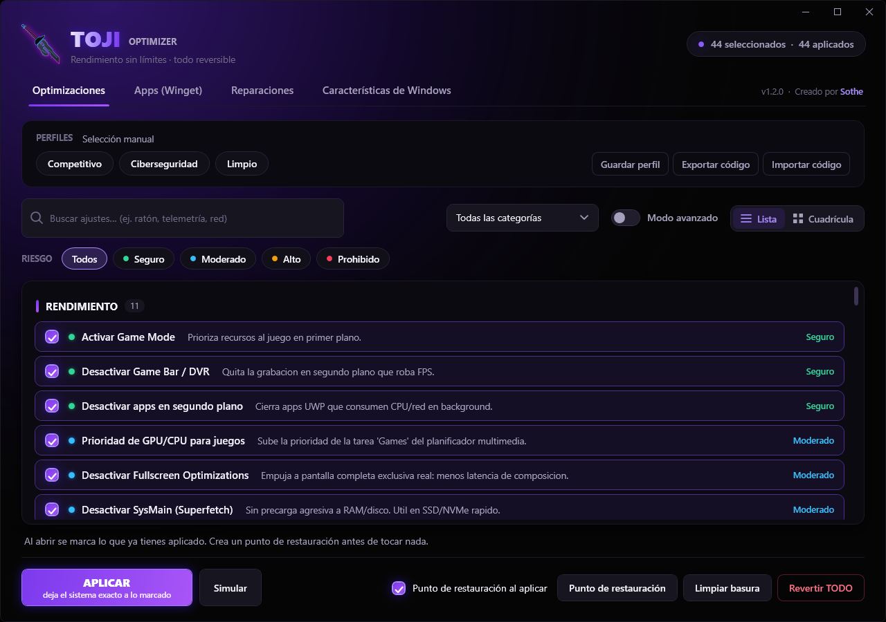
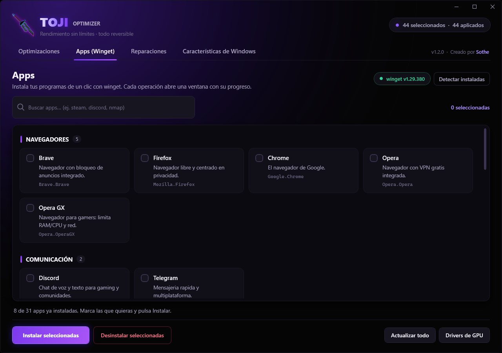
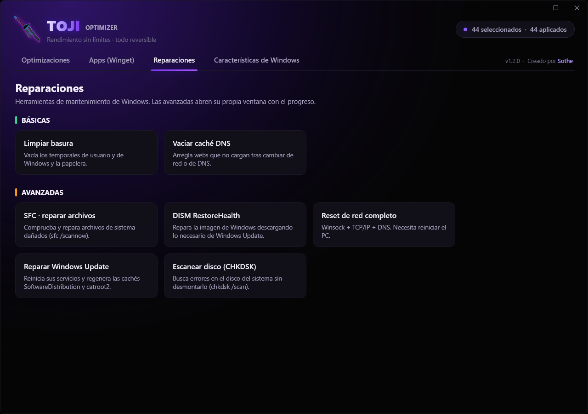
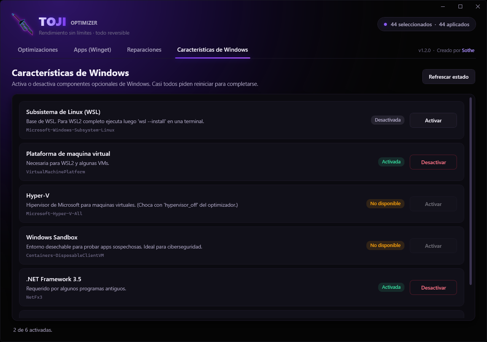

<div align="center">

# Toji

**A Windows tuning tool for power users: 70 tweaks, nothing hidden, every change undoable in the right order.**

[](https://github.com/ImSothe/Toji-Windows-Optimizer/actions/workflows/ci.yml)


-success)


</div>

<div align="center">



</div>

<table>
<tr>
<td></td>
<td></td>
<td></td>
</tr>
</table>

---

> **This repository hosts the signed release builds that Toji's auto-update downloads. The source code, issues and development live in [Toji-Windows-Optimizer](https://github.com/ImSothe/Toji-Windows-Optimizer).**
>
> **Download:** grab `SotheOptimizer.exe` from the [latest release](https://github.com/ImSothe/Sothe-Windows-Optimizer/releases/latest) (the file keeps its original name so existing installs update in place). Check it with `Get-FileHash .\SotheOptimizer.exe -Algorithm SHA256` against the `sha256` in that release's `release.json`. The binary is not Authenticode-signed yet, so SmartScreen may warn on first run (More info -> Run anyway); update integrity relies on the ECDSA signature instead.


## What it is

Toji applies **70 performance, latency, privacy and cleanup tweaks** to Windows, built for competitive gaming and
cybersecurity labs that run VMs. Unlike most "optimizer" apps it does **not** hide the dangerous settings (Defender,
firewall, Spectre/Meltdown mitigations, Hyper-V, UAC); it puts them behind an explicit Advanced Mode and asks you to
confirm. The one hard rule is that **what it changes, it can put back**.

> **Honesty first.** What wins a shooter is a high-refresh monitor, stable frametimes, a wired connection and practice.
> Registry tweaks give, at best, a single-digit percentage, and some tweaks here have **no measured effect at all**
> (see [Known limits](#known-limits)). The tool saves hours of manual tuning; it does not work miracles.

| | |
|---|---|
| **Tweaks** | 70 in 13 categories, each described as data (`tweaks.json`): registry, service, command or Appx operations |
| **Risk levels** | `safe` · `moderate` · `high` · `extreme` ("PROHIBIDO", hidden behind Advanced Mode) |
| **Apps** | 31 programs via winget, batch install and uninstall |
| **Windows features** | 6 (Hyper-V, .NET 3.5, WSL...) |
| **Profiles** | Competitive · Cybersecurity · Clean · your own, plus a shareable code (`SOTHE-1-...`) |
| **Repairs** | SFC, DISM, network reset, Windows Update repair, CHKDSK |

> The UI is in **Spanish** and so are most code comments; the documentation is in English. Internationalising the UI
> is on the roadmap.

---

## Engineering highlights

### Reversibility that survives overlapping tweaks

Each tweak stores the previous state of every operation **before** executing it, in an atomically written backup
that carries a sequence number. Reverting is **LIFO**: the last tweak applied is the first one undone, and inside a
tweak the last operation is undone first.

Registry and service operations record the previous value automatically. Command tweaks (power plans, `bcdedit`,
hibernation, scheduled tasks, MSI...) declare a read-only `capture` script whose output is stored in the backup and
handed to `apply` and `revert` as `$captured`, so a revert puts back **what was there**, not a hard-coded default. If
the capture fails, nothing is applied. `regsub` applies one value to every subkey (one per network interface) and
remembers each one's previous value.

Why that matters: two tweaks can write the same key (`defender_full_off` and `defender_realtime_off` both write
`DisableRealtimeMonitoring`). The second tweak's "previous value" is whatever the first one left. Undoing them in
alphabetical order re-applies the first tweak's value and leaves Defender's real-time protection **off after
"Revert all"**. An earlier version of this project had exactly that bug; it is now covered by regression tests that
run against a sandbox registry key (`RegistryRevertTests`).

- A crash mid-apply leaves a backup for every operation that ran, so the tweak is still revertible.
- Disabling a service stops it; reverting restores its start type **and** starts it again if it was running.
- Re-applying an already-applied tweak is a no-op (it would otherwise overwrite the original state with the modified one).
- A restore point is created automatically before the first batch of a session (opt out with a checkbox). The
  temporary `SystemRestorePointCreationFrequency = 0` needed to allow it is put back afterwards.
- A revert that fails keeps its backup, so the tweak still counts as applied and can be retried.

### Verified on a real machine, not just in unit tests

`tools/RoundTripCheck` applies and reverts tweaks on the actual Windows it runs on and diffs a snapshot of the system
(registry values, power plans and their values, services and their start type, scheduled tasks, hibernation,
`bcdedit`, HPET, MSI) before and after. On a Windows 11 machine that was already heavily tuned:

- **47 of 47** tweaks (all `safe` and `moderate` ones plus `hpet_off`, `bcd_timer` and `gpu_msi_mode`) restored the
  exact previous state after apply -> revert.
- Applying all 47 and then reverting newest-first ("Revert all") left **zero differences** from the starting state.
- The resident timer process holds the calibrated resolution, refuses a second instance and releases it on stop.

Running it the first time **found real bugs** that the unit tests could not: reverts restored hard-coded defaults, so a
custom power plan was replaced, an existing "Ultimate Performance" plan deleted, hibernation turned back on and
existing `TCPNoDelay` values removed. Those are fixed (see the commit history) and covered by tests.

Honest limits of that run: 36 of the 47 tweaks were already applied on that machine, so they showed no *change* (the
restore check still holds); `firewall_off`, `hypervisor_off`, the Defender/UAC/VBS family, `reserved_storage_off` and
the Appx debloat were **not** run live (the tool refuses security-weakening tweaks by default).

### Signed auto-update

`AppUpdater` checks the latest GitHub release (HTTPS only, GitHub hosts only), downloads `release.json` +
`release.sig` and verifies the **ECDSA P-256** signature against the embedded public key. The `.exe` is streamed to
disk with SHA-256 computed on the fly under a size cap, and only a file whose hash and size match the *signed*
manifest is staged. Installing runs a script that waits for the process to exit, backs up the current binary, swaps
and relaunches, and rolls back on failure. A standalone version of the same idea lives in
[SignedUpdater](https://github.com/ImSothe/SignedUpdater).

### Hardened data folder

`%ProgramData%\SotheOptimizer` holds backups whose `revert` field is later run as administrator, so it is treated as
untrusted input: the folder must be owned by an administrator or the system, gets a protected ACL, and anything
created by someone else is removed. System tools (`cmd`, `powershell`) are launched by absolute path.

### Timer resolution, measured

`TimerResolution` talks to `ntdll` (`NtSetTimerResolution`) and releases its request explicitly. It also
**calibrates**: asking for exactly 0.5 ms is not always what makes `Sleep(1)` most accurate. Measured on one
Windows 11 machine (supported range 0.500-15.625 ms), 4 alternating rounds of 150 samples:

| Requested | Mean `Sleep(1)` |
|---|---|
| default timer | 15.58 ms |
| 0.500 ms | 1.54 ms |
| 0.515 ms | **1.16 ms** |

It costs a little more jitter (stddev ~0.22 ms vs ~0.16 ms) and it is hardware dependent, so the resident process
measures a sweep at install time and holds the best value. A measured negative result is documented too: on Windows 11
a resident process drops the *system* clock to 0.5 ms, but **other** processes' `Sleep(1)` stays at ~15.5 ms unless
the `GlobalTimerResolutionRequests` registry opt-in is set (which the tweak does, and which may need a reboot). The
standalone library is [WindowsTimerResolution](https://github.com/ImSothe/WindowsTimerResolution).

---

## Tests

```powershell
dotnet test tests/SotheOptimizer.Tests -c Release
```

**172 tests**, ~2 s. Line coverage is **87.5 %** (788 / 901) and branch coverage 72.5 %, measured with `coverlet`
over the engine, updaters, signing, storage hardening and timer code. The WPF windows (about 1.6k lines) are **not**
covered, so that figure is not the coverage of the whole product. The registry round-trip tests only ever touch
`HKCU\Software\TojiTests\<guid>`.

## Build

```powershell
dotnet build SotheOptimizer.sln -c Release
dotnet publish src/SotheOptimizer -c Release     # single self-contained SotheOptimizer.exe, runtime included
```

Requires the .NET 8 SDK on Windows 10/11 x64. The app asks for administrator rights (UAC) because it edits HKLM,
services and system features. `tools/OtaSigner` generates the signing key pair and signs releases and data files;
the **private key is never in the repo**. See [src/SotheOptimizer/BUILD.md](https://github.com/ImSothe/Toji-Windows-Optimizer/blob/main/src/SotheOptimizer/BUILD.md) (Spanish).

## Layout

```
src/SotheOptimizer/
  SotheEngine.cs        apply / revert, LIFO backups, registry + services + commands
  AppUpdater.cs         signed self-update          DataUpdater.cs   signed data (OTA, currently off)
  SignedData.cs         ECDSA verification          SecureStorage.cs hardened %ProgramData%
  TimerResolution.cs    ntdll timer + calibration   PowerShellRunner.cs  hidden PowerShell with real error detection
  data/*.json           tweaks, apps, features, profiles (embedded in the exe)
  MainWindow*.cs/xaml   WPF UI
tests/SotheOptimizer.Tests/   xUnit
tools/OtaSigner/              key generation and signing
tools/RoundTripCheck/         real apply/revert check with before/after system snapshots
```

## Known limits

- **Not every tweak is reversible.** Appx debloat cannot be reinstalled automatically (the app says so). A setting
  that was never explicitly set in a power plan (for example `CPMINCORES` on some custom plans) has no value to put back,
  so its revert is skipped. `reserved_storage_off` and the security-weakening tweaks have not been verified live.
- **No measurements for most tweaks.** Several performance tweaks (for example `nagle_off`, `gaming_gpu_priority`,
  `game_mode`) are community folklore with no measured effect on modern Windows; treat them as optional. On current
  Windows, Defender tweaks are also ignored while Tamper Protection is on.
- `HKCU` tweaks apply to the account that elevated the process, which is not the interactive user if a different
  administrator's credentials were used at the UAC prompt.
- The binary is not Authenticode-signed, so SmartScreen warns on first run. Update integrity does not depend on it.
- The OTA data channel is implemented and tested but disabled (no base URL configured).

Reproducible findings from the security review that preceded open-sourcing live in the commit history
(`Revert in LIFO order, back up before each operation...`).

## Disclaimer

Toji modifies deep Windows settings. **Use it at your own risk**: some tweaks disable security protections or can
cause instability. A restore point is created automatically; keep it enabled. Provided "AS IS", without warranty.

## License

[MIT](https://github.com/ImSothe/Toji-Windows-Optimizer/blob/main/LICENSE)

Built with AI-assisted development (Claude Code); the design, the decisions and the verification are mine. Contact:
[LinkedIn](https://www.linkedin.com/in/%C3%A1ngel-baz-monteiro-8196a21a9/)
